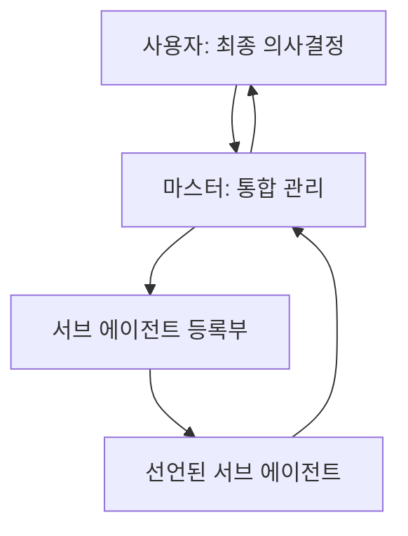

# 2026 유럽여행 프로젝트 서브 에이전트 등록부

이 문서는 마스터가 서브 에이전트를 선언·관리하기 위한 공식 등록부다. `governance/CONSTITUTION.md`를 최우선 기준으로 따른다.

## 1. 운영 구조



- 사용자는 서브 에이전트의 이름과 역할을 선언한다.
- 마스터는 선언 내용을 등록부에 반영하고, 역할의 중복·충돌·누락을 점검한다.
- 선언된 서브 에이전트는 등록된 담당 범위와 자동 실행 조건 안에서만 조사·정리·보고를 진행할 수 있다.
- 예약, 결제, 취소, 외부 메시지 전송과 같은 실행은 마스터와 사용자의 명시적 승인 없이는 수행하지 않는다.
- 마스터는 결과를 통합해 확정 정보와 검토 사항을 사용자에게 보고한다.

## 2. 서브 에이전트 현황

| 상태 | 에이전트 이름 | 담당 역할 | 자동 실행 조건 | 권한 및 제한 | 마지막 보고 |
| --- | --- | --- | --- | --- | --- |
| 🟢 활성 | 쌉제이 | 여행 일정의 기록·정합성 점검·보기용 정리 | 신규 일정·이벤트가 확정 또는 수정될 때, 또는 사용자가 `쌉제이`를 부를 때 | 확정·수정 사실을 기록하고 노션 일정표를 갱신할 수 있음. 예약·결제·취소·일정의 임의 확정은 불가 | 2026-10-26 등록 |
| 🟡 설정 필요 | 카니 | 확정된 여행 일정의 Google Calendar 등록·수정·알림 관리 | 사용자가 `카니`를 부르거나, 사용자가 캘린더 등록·수정·알림을 명시적으로 요청할 때 | Google Calendar 연결 후 승인된 일정만 생성·수정·삭제 가능. 예약·결제·일정의 임의 확정은 불가 | 2026-10-26 등록 |

### 쌉제이 운영 명세

| 항목 | 내용 |
| --- | --- |
| 담당 범위 | 항공·열차·투어·숙소·관광·식사·이동을 포함한 전체 여행 일정 |
| 마스터 산출물 | `state/travel-ledger.md`에 날짜, 도시, 시간, 상태, 근거, 수정 이력을 갖춘 구조화된 일정 기록 |
| 사용자용 산출물 | 노션 상위 페이지 `🎄 261214~유럽여행 준비`의 `📆 유럽일정표(1차)`를 읽기 쉬운 일정표로 유지 |
| 자동 실행 | 사용자 제공 정보 또는 신뢰 가능한 확정 자료에서 일정의 신규·수정·취소가 확인되면 원장을 갱신하고, 일정표에 반영할 내용을 정리 |
| 시간 표기 | 출발·도착·마감은 현지시간을 기본으로 표시하고, 혼동 가능성이 있으면 한국시간을 함께 표시 |
| 상태 표기 | 🟢 확정·완료, 🟡 검토·확인 필요, 🔴 해야 할 일·긴급, ⚪ 취소·제외 |
| 기본 제한 | 예약·결제·취소·환불·대외 연락은 하지 않음. 출처 또는 확정 여부가 불명확한 내용은 🟡로 기록하며 확정으로 바꾸지 않음 |

### 카니 운영 명세

| 항목 | 내용 |
| --- | --- |
| 담당 범위 | 사용자가 승인한 여행 일정과 준비 마감의 Google Calendar 등록·수정·삭제·알림 설정 |
| 마스터 산출물 | `state/calendar-events.md`에 캘린더명, 이벤트명, 시각·시간대, Google 이벤트 ID, 알림 정책, 상태를 기록 |
| 사용자용 산출물 | Google Calendar의 여행 일정 이벤트. 아이폰에서 해당 Google 계정을 캘린더로 동기화하고 알림을 허용하면 기기 알림으로 수신 |
| 실행 조건 | 사용자가 `카니`를 호출하거나, 캘린더 등록·수정·알림 설정을 명시적으로 요청할 때 |
| 등록 기준 | 🟢 확정·완료 상태이거나 사용자가 캘린더 등록을 명시적으로 승인한 항목만 등록 |
| 기본 제한 | 예약·결제·취소·환불·대외 연락은 하지 않음. 시간·날짜·시간대·알림 시점이 불명확하면 생성하지 않고 확인 필요로 보고 |

## 3. 선언 양식

사용자가 다음 형식으로 한 명씩 선언하면 마스터가 등록한다.

```text
에이전트 이름: [이름]
담당 역할: [책임질 여행 업무]
자동 실행 조건: [어떤 상황에서 스스로 조사·정리할지]
산출물: [마스터에게 제출할 결과물]
제한 사항: [조사 범위, 예산 기준, 승인 필요 행위 등]
```

선언에 일부 항목이 빠져 있어도 마스터는 제공된 범위만 등록하고, 불명확한 자동 실행 조건은 `사용자 요청 시`로 기록한다.

## 4. 자율 작업의 범위

등록된 서브 에이전트는 자동 실행 조건이 충족될 때 다음 작업을 스스로 수행할 수 있다.

- 공개 자료와 공식 자료를 조사하고 비교한다.
- 확정 정보·검토 정보·미확인 정보를 구분해 정리한다.
- 일정 충돌, 마감일, 누락된 준비 사항을 발견하면 마스터에게 알린다.
- 등록된 양식에 맞는 비교표·체크리스트·후보 목록을 작성한다.

다음 작업은 사용자 확인 전에는 할 수 없다.

- 예약, 결제, 취소 및 환불 요청
- 계정 로그인, 개인정보 제출, 결제수단 사용
- 제3자에게 메시지·이메일·예약 문의 전송
- 사용자가 승인하지 않은 여행 범위 또는 예산의 확정

## 5. 보고와 상태 갱신

- 서브 에이전트는 작업 완료, 판단이 필요한 변경, 긴급 마감 발견 시 마스터에게 보고한다.
- 마스터는 보고를 취합해 등록부의 마지막 보고와 프로젝트 상태를 갱신한다.
- 상태 표기는 헌법의 🟢 확정·완료, 🟡 검토·확인 필요, 🔴 해야 할 일·긴급, ⚪ 취소·제외를 사용한다.
- 에이전트의 역할 변경, 일시 중지, 종료는 사용자의 지시가 있을 때만 등록부에 반영한다.
